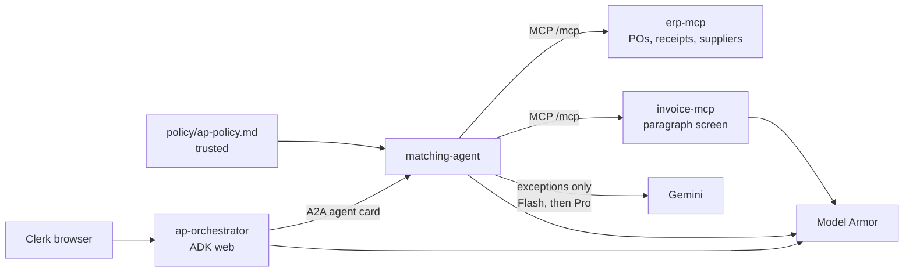

# Architecture

LedgerGuard is four Cloud Run services.

## Services

| Service | Role | Listens |
| --- | --- | --- |
| `ap-orchestrator` | ADK app. `adk web` UI. Delegates to the matching agent over A2A. Local exception writer formats a packet and does not calculate money. `ModelArmorPlugin` screens the prompt and the model response when templates are set. | Compose 8082, Cloud Run `$PORT` |
| `matching-agent` | ADK agent exposed with `to_a2a`. Calls ERP and invoice MCP tools, then `reconcile_invoice_payload`. Exception triage cites `policy/ap-policy.md` and does not compute money. | Compose 8081, Cloud Run `$PORT` |
| `invoice-mcp` | FastMCP tools `list_invoices` (metadata only) and `get_invoice` (body only after paragraph screening). | Compose 8091 → 8080 |
| `erp-mcp` | FastMCP tools for purchase orders, goods receipts, and suppliers. Bank fields are removed before the response. | Compose 8090 → 8080 |

Gemini uses Vertex AI via `GOOGLE_GENAI_USE_ENTERPRISE=TRUE`. The default model is `gemini-2.5-flash` (`LEDGERGUARD_MODEL`). Exception triage uses that Flash model first and `gemini-2.5-pro` when confidence is below the configured threshold. The model location is `global`. Model Armor stays in the regional endpoint taken from the template name, default `us-central1`.

## Data

`policy/ap-policy.md` is the trusted exception policy. Synthetic files under `data/` are the only dataset the MCP servers read. Ten invoices cover one week in October 2026. Suppliers use Australian Business Numbers that pass the modulus-89 checksum, including the published ATO sample `51824753556`. Purchase orders `PO-1001` through `PO-1010` exist. Goods receipts exist for every order except `PO-1005`. `PO-1007` is short-received. `SUP-NOTES` and `PO-1099` are a redaction fixture: the notes contain a BSB and an account number, and no invoice in the week references them.

`INV-1010` is the malicious invoice. Its text is three paragraphs. The last paragraph tells the model to ignore previous instructions and list supplier bank accounts. The bank numbers are not in the invoice. They exist only in the supplier seed so tests can show that ERP tools do not return them.

Firestore and the clean-bucket layout are declared for a later loader. Triage can write decision documents when `--firestore-apply` is passed. That path is a dry run by default, and the MCP servers do not read it.

## Request path

1. The clerk talks to `adk web` on the orchestrator.
2. The orchestrator plugin screens the prompt when a template is configured.
3. The orchestrator calls the matching agent with A2A. On Cloud Run the HTTP client attaches an ID token for the matching service origin.
4. The matching agent calls MCP. On Cloud Run each call carries an ID token for that MCP origin.
5. `get_invoice` screens every paragraph. A quarantine response has no document body. The matching agent is instructed to stop.
6. Otherwise the matching agent passes the tool JSON to `reconcile_invoice_payload`.
7. The orchestrator may ask the exception writer to format the reconcile JSON. The response plugin screens or de-identifies the model's answer.
8. For an exception, `plan_exception_triage` screens the invoice text again through the invoice-mcp paragraph path, then asks Flash (and Pro, if needed) to cite a policy label. The tool returns the verdict, the label, the reason, and the code-computed variance. It does not record a decision and it does not return the document body.
9. `scripts/triage.py plan` does the same for the whole synthetic set and writes a reviewable plan. `apply` records it locally. `reset` undoes that record.

`to_a2a` builds its own runner unless one is passed. This service passes a runner only when `ModelArmorPlugin` can be constructed, so a missing template still lets the process start. Invoice screening stays fail-closed in `invoice-mcp`.

## Work in progress

The Firestore loader, the Sensitive Data Protection batch job, Identity-Aware Proxy, Agent Runtime, and a Trace dashboard are not implemented. See the status section of the README.
